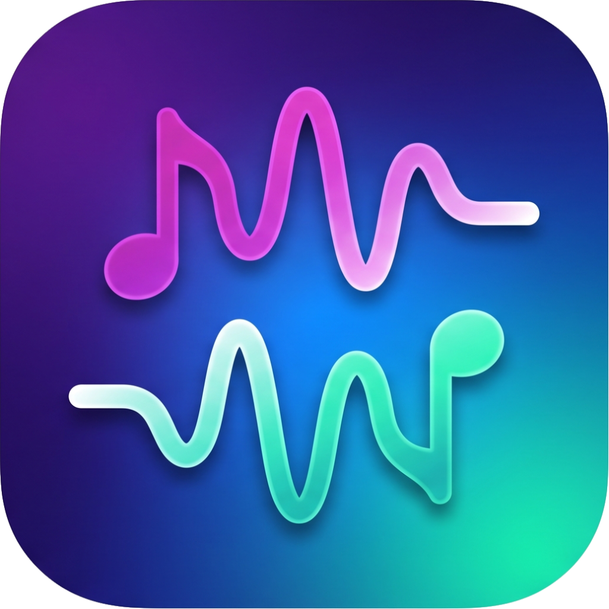

# Antiphon

<p align="center">
  
</p>

> **Antiphon**: *A responsive playlist synchronization bridge between Spotify and Apple Music.*

Antiphon is a native iOS app built in SwiftUI that bridges the gap between Spotify and Apple Music. It links playlists across both services, previews every sync, and keeps them matching, with a Liquid Glass interface in light and dark.

---

## 💡 What Antiphon Solves

Streaming platforms are walled gardens. If you collaborate on a Spotify playlist with friends but listen primarily on Apple Music (or vice versa), keeping them in sync manually is a nightmare. Antiphon solves this by:
* **True Bidirectional Syncing**: Allowing updates on either platform to propagate to the other.
* **Smart Matching**: Performing robust ISRC-based matching with fallback fuzzy title/artist normalizations to handle variations in titles (e.g. `Song (Remix)` vs `Song - Remix`).
* **Conflict & Removal Flags**: Detecting track deletions and destination-only tracks, then presenting them to you in a clean, flag-resolution interface instead of silently deleting your songs.
* **Local Caching**: Keeping a local SwiftData cache of your playlist alignments to speed up subsequent scans.

---

## 🚀 Key Features

* **Seams**: link a Spotify playlist with an Apple Music one, one way or both ways. Every sync starts with a preview that says exactly what will change.
* **Honest matching**: ISRC first, then title, artist and length, with confidence bands. Close matches wait in a review queue instead of being guessed. Preferences cover explicit/clean, remasters, live versions, radio edits and which album.
* **Nothing removed by surprise**: removals are kept, asked about, or mirrored, as you choose, and any sync can be undone from Activity.
* **Track order**: new tracks land next to the same neighbours as on the other side, or the target follows the source's order entirely, wherever the platform allows it.
* **Library and search**: both libraries in one grid, availability checks before you stitch a playlist, and a search across your seams.
* **Monitoring**: background checks per seam with Wi-Fi, Low Power and quiet-hours gates, and notifications split by whether you need to act.
* **Light and dark**: a Liquid Glass UI built on iOS 26, with a System / Light / Dark setting that the Home Screen icon follows.

---

## 📖 Developer Documentation

For a deep dive into architecture and algorithm implementation details, refer to the following documents:
* [Architecture Guide](docs/ARCHITECTURE.md): Concurrency model (Actors & @MainActor), project folder structure, and SwiftData database schema.
* [Playlist Sync Engine Guide](docs/SYNC_ENGINE.md): Technical overview of the delta matching pipeline, fuzzy matching rules, override actions, and sync safety thresholds.
* [Redesign plan](docs/redesign-plan.md): the iOS 26 redesign, decisions, and what each milestone shipped and verified.
* [Agent notes](CLAUDE.md): build/test/screenshot/self-test commands, architecture map, and gotchas.

---

## 🛠 How It Is Built

Antiphon is built as a native Swift application using modern Apple frameworks:
* **UI**: SwiftUI (declarative layout, navigation stack, and animated transitions).
* **Database / Cache**: SwiftData (local schema models for `SyncPair`, `CachedTrack`, and `SyncLog`).
* **Concurrency**: Modern Swift Concurrency (`async/await`) with strict thread safety isolated to the `@MainActor`.
* **Project Generation**: XcodeGen (de-clutters Git by generating the `.xcodeproj` dynamically from a `project.yml` specification).

---

## 💻 How to Build and Run

### Prerequisites
* macOS 15+
* Xcode 26+ (iOS 26 SDK)
* Swift 6.0 (strict concurrency enabled)
* [XcodeGen](https://github.com/yonaskolb/XcodeGen)

### Step-by-Step Setup

1. **Install XcodeGen** (if not already installed):
   ```bash
   brew install xcodegen
   ```

2. **Set your Developer Team environment variable**:
   Export your Development Team ID so XcodeGen can resolve signing automatically:
   ```bash
   export DEVELOPMENT_TEAM="YOUR_TEAM_ID"
   ```
   You can find your Team ID in the [Apple Developer portal](https://developer.apple.com/account) under Membership Details. Add the export to `~/.zshrc` to persist it.

3. **Generate the Xcode Project**:
   Run the project generator from the root directory:
   ```bash
   xcodegen generate
   ```
   This reads `project.yml`, resolves your `DEVELOPMENT_TEAM` environment variable, and creates `Antiphon.xcodeproj` with all build phases, assets, schemes, and signing parameters correctly mapped.

4. **Open and Run**:
   ```bash
   open Antiphon.xcodeproj
   ```
   Select your target (e.g. iPhone Simulator or Mac), hit **Cmd + R**, and run!

---

## 🧘‍♂️ The "Vibecoded" Disclaimer

> [!IMPORTANT]
> **This codebase was vibecoded.** 
> It was built with absolute vibe-centric energy by highly capable agentic AI models, supervised by a human mobile developer who acted as our designated anchor to reality. 
> 
> *   **What the AI models did**: Wrote optimized NSRegularExpressions, solved strict concurrency boundaries, designed the premium Glassmorphic theme, and kept the Git files tidy.
> *   **What the developer did**: Reviewed plans, approved shell commands, prevented the models from recursively deleting the workspace database, and made sure we didn't add arbitrary Node.js packages to a native Swift application.
> 
> Proceed with caution, enjoy the smooth transitions, and may your playlists remain forever in sync.
