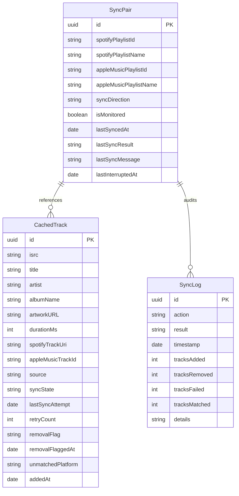

# Antiphon Architecture

This document describes the design patterns, system architecture, database schema, concurrency model, and folder structure of the Antiphon codebase. It serves as a technical source of truth for developers and AI agents.

---

## 🗺 Directory Structure

The current folder map (after the iOS 26 redesign) and the sync flow are in [`CLAUDE.md`](../CLAUDE.md#architecture-redesign-layer); the screen-by-screen plan is in [`redesign-plan.md`](redesign-plan.md). In short: pure planning lives in `Core/Sync/Planning`, live reads and writes in `Core/Sync/Live`, the engine in `Core/Sync`, screens talk to `Services/` protocols (each with live and preview implementations), and the UI kit is the `Packages/AntiphonDesign` package.

---

## ⚡ Concurrency & Thread Safety

Antiphon uses modern Swift Concurrency (`async/await`) and strict compiler isolation checks to ensure database and UI thread safety:

### 1. Actor Isolation (`SyncEngine`)
All heavy network fetches, database computations, and alignment algorithms run inside the `SyncEngine` actor.
* **Database Context isolation**: The actor creates its own dedicated `ModelContext` using `ModelContext(modelContainer)`. Because actors serialize execution, database transactions run safely off the main thread, preventing UI lag and thread violation crashes.
* **Resume Interruption Checks**: The engine records `lastInterruptedAt` if an active sync is cancelled or interrupted (e.g., app goes to background). When restarted, the engine skips Stage A and resumes Stage B matching using existing pending database states.

### 2. Token Provider (`SpotifyTokenProvider` actor)
`SpotifyTokenProvider` is a self-contained actor that manages Spotify access token lifecycle — reading tokens from Keychain, refreshing when expired, and writing updated tokens back. Any code that needs a Spotify token — foreground UI, background task, or App Intent — simply creates `SpotifyTokenProvider()` and calls `validAccessToken()`. The Keychain is the shared source of truth; multiple provider instances never share mutable in-memory state.

Refreshes are additionally serialized **process-wide** via a static `SpotifyRefreshGate`: separate provider instances can never refresh concurrently. This prevents Spotify's refresh-token rotation race, where two simultaneous refreshes make the loser receive `400 invalid_grant` — which would otherwise delete every Spotify credential from the Keychain and silently sign the user out. The gate uses double-checked locking: after acquiring it, the Keychain is re-read so a waiting caller reuses the winner's fresh token instead of POSTing again. `forceRefreshedToken(rejecting:)` supports the API client's 401 recovery, which retries a failed request once with a freshly refreshed token.

### 3. Main-Actor UI Isolation (`@MainActor`)
UI-facing managers are fully `@MainActor`-isolated at the class level, ensuring compile-time data-race safety for all observable state without relying on `@unchecked Sendable`:
* **`SyncCoordinator`**: A `@MainActor @Observable` class that bridges the SwiftUI UI and the background `SyncEngine` actor. It manages task handles, progress state, and sync results. `startSync()` creates a `SpotifyAPIClient` (which internally uses `SpotifyTokenProvider`) — no `SpotifyAuthManager` dependency needed.
* **`SpotifyAuthManager`**: A `@MainActor @Observable` class that owns UI-only auth state: login/logout flows (OAuth PKCE), user profile display, BYOK Client ID management, and the observable `isAuthenticated` flag. It writes tokens to Keychain during login (consumed by `SpotifyTokenProvider`), but does **not** manage token refresh or provide tokens to API callers. The `ASWebAuthenticationPresentationContextProviding` conformance uses `@preconcurrency` with `MainActor.assumeIsolated`.
* **`AppleMusicManager`**: A `@MainActor @Observable` class managing MusicKit authorization status and library access. Provides a `nonisolated init()` so SwiftUI views can create instances as stored properties. All API methods call `ensureAuthorized()` which checks `MusicAuthorization.currentStatus` live rather than relying on the cached observable property — this is critical for fresh instances created by background tasks and the sync coordinator, which never receive a `refreshStatus()` call.
* **Screen models** (`SyncsHomeModel`, `SeamDetailModel`, `SyncFlowModel`, `LibraryModel`, `ActivityModel`, `SettingsModel`, `OnboardingModel`, …) are `@MainActor @Observable` classes that call `Services/` protocols, so previews and tests can use fixtures.

### 4. Background Task Isolation
Background execution contexts (`BackgroundTaskManager`, `SyncPlaylistsIntent`) create a `SpotifyAPIClient()` directly — which uses its own `SpotifyTokenProvider` internally. No `SpotifyAuthManager` is needed for background work, cleanly separating background token access from foreground UI auth state.

### 5. Local Notifications
Background runs (`MonitorRun.perform`) decide what to say with `MonitorNotifications`. There are four categories the person controls in Settings: need to decide, something breaks, new tracks (each sync or a daily summary) and a weekly digest. `NotificationScheduler` rewrites the scheduled summary and digest after each run. Permission is asked for in onboarding or when a notification is turned on, not at launch. The Shortcuts intent still uses `NotificationManager.postSyncFailureNotification` and respects "When something breaks".

---

## 🗄 Storage Schema (SwiftData Models)

Antiphon stores its data in SwiftData. The diagram shows the three original models. Since the redesign there are also `SyncChange` (one row per write a run made, ordered by `sequence`, used for history, New tracks and undo; cascades from `SyncLog`) and `SyncProblem` (open problems per seam). `SyncPair` gained rule fields (`removalPolicy`, `monitorIntervalMinutes`, `newTrackPlacement`, `pausedAt`, `…CreatedByAntiphon`, `needsRebuild`), and `CachedTrack` gained match evidence (`matchConfidence`, `matchReason`, `candidatesData`, `removalKeptAt`…). All new fields are optional or defaulted, so stores migrate in place. Reset deletes object by object, because batch deletes fail on the run → change relationship.

### 1. `SyncPair`
Represents a configured playlist link between Spotify and Apple Music.
* **Key fields**: `syncDirection` (unidirectional vs bidirectional), `spotifySnapshotId` (to detect remote changes), and `lastSyncResult` (stores success, failure, or partial outcomes).

### 2. `CachedTrack`
Stores the alignment metadata for a single track.
* **Matching Keys**: Dual-platform keys (`spotifyTrackUri` and `appleMusicTrackId`) mapped to a shared global key (`isrc`).
* **Conflict State**: Stores dynamic `removalFlag` (e.g. track removed on source platform) and `unmatchedPlatform` (flagged if target platform search failed).

### 3. `SyncLog`
An immutable log auditing the details of every sync action. Records specific counts for additions, removals, failures, and matches, along with diagnostic details.
* **Result Status**: The `result` field (`SyncResultStatus`) captures the overall sync outcome (success, partial, failed). This ensures failed syncs are never collapsed into "no changes" aggregates in the history UI — they are always surfaced individually with error styling.
